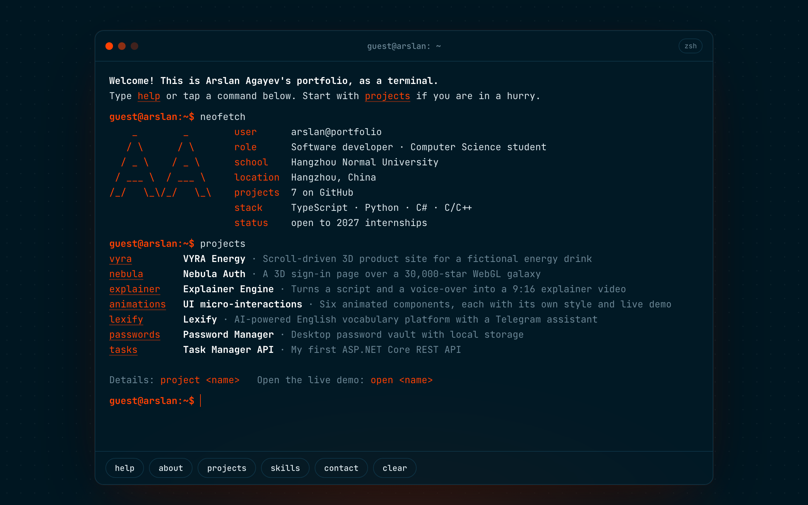

# Terminal Portfolio

My portfolio as a terminal. Type `help`, `projects` or `contact`, or tap the commands at the bottom on a phone.

**Live:** [arslanagayev.github.io](https://arslanagayev.github.io/)



## What it does

- **Real shell habits.** Tab completes commands and project names, ↑ ↓ walk through history, Ctrl+L clears the screen and Ctrl+C drops the current line.
- **Forgives typos.** `projct vyra` answers with "Did you mean `project vyra`?", using an edit distance that counts swapped letters as one mistake.
- **Ghost suggestions.** When only one completion fits, the rest of it appears in grey after the cursor; → accepts it.
- **Clickable output.** Every command name in the output is a button and every URL is a link, so the site also works without a keyboard.
- **Deep links.** `?run=projects` or `?run=contact` types that command after the intro, so a CV can link straight to a section.
- **Fits any screen.** The terminal knows how many characters fit on a line (like `$COLUMNS`), so `neofetch` stacks its logo above the facts on a phone.
- **Accessible.** Output is an ARIA live log, the prompt is a labelled input, motion is skipped for people who prefer reduced motion, and there is a `<noscript>` fallback with my links.

| Command                                                           | What it shows                                 |
| ----------------------------------------------------------------- | --------------------------------------------- |
| `help`                                                            | every command, clickable                      |
| `about` · `skills` · `contact`                                    | who I am, what I use, where to reach me       |
| `projects` · `project <name>`                                     | my projects and the details of one            |
| `open <name>`                                                     | a live demo, a repo or a profile in a new tab |
| `neofetch` · `ls` · `cat` · `history` · `echo` · `date` · `clear` | the usual terminal things                     |

There are a few easter eggs too. Try what you would try on a real server.

## How it works

```
src/
  data/profile.ts     everything the terminal knows about me (projects, skills, links)
  core/parse.ts       splits a line into words, with quotes, like a shell
  core/commands.ts    the commands: each one returns lines of styled segments, never HTML
  core/complete.ts    tab completion for command names and their arguments
  core/suggest.ts     "did you mean" with Damerau-Levenshtein distance
  core/history.ts     ↑ ↓ history that keeps what you were typing
  ui/terminal.ts      turns segments into DOM, handles keys, clicks and typing animation
  main.ts             intro, neofetch and ?run= deep links
```

Commands are pure: they take the arguments plus a small context (history, time, columns) and return lines. That keeps the logic testable without a browser, and the UI layer only decides how a segment looks: plain text, a link or a button that runs another command.

## Run it

Needs Node.js 22 or 24.

```bash
npm install
npm run dev
```

```bash
npm test            # 66 tests: parser, completion, suggestions, every command, the DOM terminal
npm run lint        # ESLint with strict type-checked rules
npm run build       # type-check and build to dist/
```

GitHub Actions runs lint, formatting, type-check, tests with coverage and the build on Node 22 and 24, and deploys `main` to GitHub Pages.

## Design

Combo **Vulcanico #FF4103** on **Noturno #001621**, set in JetBrains Mono. One accent colour does all the work: prompt, links, commands and the logo.

## License

[MIT](LICENSE)
